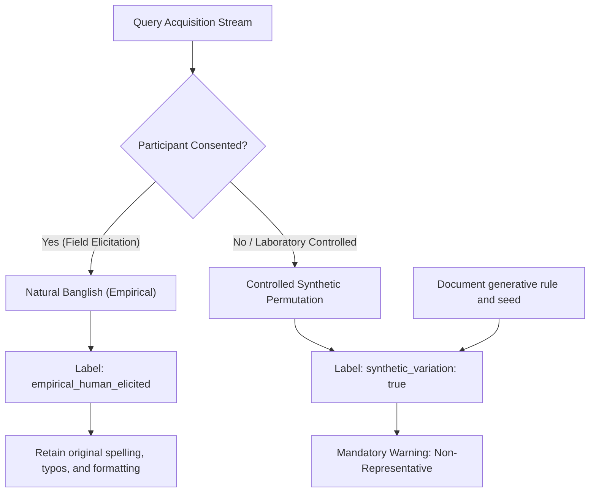

# Legal Aid BD — Banglish Variation and Transliteration Protocol

**Document Identifier**: `DOC-PROTO-W3-002`  
**Milestone**: Week 3 Empirical Lexical Modeling  
**Research Pipeline**: Cross-Script and Multilingual Legal Retrieval for Bangladesh  
**Status**: Approved Protocol  

---

## 1. Background & Linguistic Reality

In Bangladesh, a vast proportion of internet users access digital services using smartphone keyboards configured for the Latin alphabet. They communicate in **Banglish** (phonetic Bengali written in the Latin alphabet) rather than standard Bengali Unicode (বাংলা লিপি).

Unlike formal languages with standardized orthographies, Banglish has **no official spelling standard**, no standard keyboard mapping, and exhibits high intra-speaker and inter-speaker variance. A citizen seeking legal advice regarding landlord eviction might write:
- *"Bariwala ki iccha moto rent barate parbe?"*
- *"bari ola icchamawto vara baria keno evict kore?"*
- *"landlord jodi bhara bariye uthai dite chay ki korbo?"*

Evaluating retrieval models on clean Bengali script alone creates a false impression of model readiness while leaving the system completely fragile when deployed to real citizens.

---

## 2. Real vs. Synthetic Data Governance

To protect scientific integrity, the benchmark enforces a strict division between empirical human-elicited queries and controlled synthetic variations:

> [!CAUTION]
> **Strict Scientific Policy on Synthetic Data**  
> Synthetic spelling perturbations are valuable for unit testing character n-grams and phonetic encoders; however, **synthetic queries must never be presented as representative public usage**.  
> In all publications, benchmark tables, and release manifests, synthetic records must bear `synthetic_variation: true`.

---

## 3. Human Elicitation Protocol (Consenting Participants)

When collecting natural Banglish queries from bilingual speakers:

1. **Informed Consent**: Every participant receives a plain-language explanation stating that their submitted queries will be used exclusively for open-access AI benchmark research and will not be tied to their legal identity.
2. **Neutral Scenario Prompting (No Leading Text)**:
   - **Prohibited Elicitation**: Providing a Bengali sentence and asking the user to *"type this in English letters"* (this induces artificial character-by-character transliteration).
   - **Mandatory Elicitation**: Presenting a visual or situational vignette (e.g., *"Imagine you were fired from your factory job today without any advance notice. What would you search online to find out what the owner owes you?"*).
3. **Anonymization**: Any accidental personal identifiers (names of persons, specific village or moholla names, corporate employer names, phone numbers) are redacted with generic tokens (`[PERSON]`, `[EMPLOYER]`) prior to benchmark storage.

---

## 4. Controlled Synthetic Variation Taxonomy

When expanding test suites under laboratory conditions, synthetic variants are generated across four linguistic dimensions:

### 4.1 Inconsistent Vowel Graphemes
Bengali vowels have multiple Romanized representations:
- **আ (aa/a)**: *ভাড়া* $\to$ `bhara`, `bhaara`, `vara`
- **ই / ঈ (i/ee)**: *চুক্তি* $\to$ `chukti`, `chukti`, `chookti`
- **উ / ঊ (u/oo)**: *মূল্য* $\to$ `mullo`, `mulyo`, `moolyo`
- **এ / অ্যা (e/ae)**: *মেয়াদ* $\to$ `meyad`, `maeyad`, `meyaad`
- **ও (o/u)**: *দোকান* $\to$ `dokan`, `dukan`

### 4.2 Phonetic Consonant Alternations
Regional and colloquial phonetic shifts:
- **শ / ষ / স (sh vs. s)**: *শাস্তি* $\to$ `shasti`, `sasti`, `shashti`
- **চ / ছ (ch vs. c vs. chh)**: *চাকরি* $\to$ `chakri`, `cakri`, `chhakri`
- **ভ / ব (bh vs. v vs. b)**: *ভেজাল* $\to$ `bhejal`, `vejal`, `bejal`
- **খ (kh vs. k)**: *খুচরা* $\to$ `khuchra`, `kuchra`
- **জ / য (j vs. z)**: *জমি* $\to$ `jomi`, `zomi`

### 4.3 Vowel Elision & Conversational SMS Contractions
Frequent omission of unaccented vowels in fast mobile typing:
- *হবে* $\to$ `hobe`, `hbe`, `hb`
- *করলে* $\to$ `korle`, `krle`
- *কিন্তু* $\to$ `kintu`, `kntu`
- *কোনো* $\to$ `kono`, `kno`
- *টাকা* $\to$ `taka`, `tk`

### 4.4 Code-Mixing & Embedded English Legal Loanwords
Bangladeshi citizens naturally insert English institutional and commercial terms into Bengali syntactic structure:
- *"Amar **overtime payment** dey nai, **Labour Court** e kivabe **case file** korbo?"*
- *"**Contract agreement** a sign na thakle ki **deed** legal hobe?"*
- *"**Landlord notice** chara **security deposit** atkay rakhse."*

---

## 5. Tokenization & Handling Protocol in the Retrieval Pipeline

1. **Dual-Path Routing**:
   - The query router inspects character script ratios. If Latin characters exceed 80% while English dictionary lookup fails for key verbs (*korle*, *hobe*, *pabo*, *dile*), the query is flagged as `banglish`.
2. **Preservation of Raw String**:
   - The original raw query string is never irreversibly altered.
3. **Phonetic & Subword Expansion**:
   - Character 3-grams are generated for lexical matching (e.g., `dokandar` $\to$ `dok`, `oka`, `kan`, `and`, `nda`, `dar`).
   - A curated equivalence dictionary maps high-frequency colloquial terms (*chukti* $\leftrightarrow$ *চুক্তি*, *jomi* $\leftrightarrow$ *জমি*, *bhejal* $\leftrightarrow$ *ভেজাল*).

