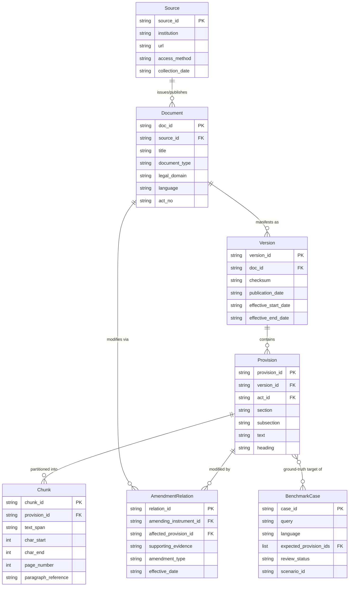

# Legal Aid BD — Legal Data Schema Design Note

**Document Identifier**: `DOC-SCHEMA-D2-001`  
**Milestone**: Day 2 Minimal Research-Ready Legal Data Schema  
**Research Project**: *Cross-Script and Multilingual Legal Retrieval for Bangladesh*  
**Date**: 2026-10-23  
**Status**: APPROVED & EMPIRICALLY VERIFIED (39/39 Tests Passing)  

---

## 1. Executive Summary & Design Objective

The Day 2 milestone introduces the **minimal, research-ready legal data schema** for the Legal Aid BD project. 

The schema enforces strict relational integrity, end-to-end statutory provenance, and multilingual Unicode safety without introducing external relational database servers (e.g., PostgreSQL) or heavyweight ORMs. It is implemented in standard Python (`dataclasses`, `typing`, `enum`, `json`) and directly reflects the empirical reality of Bangladesh legal publishing.

### Core Acceptance Criterion
> **No provision can exist without a traceable source and document version.**

This invariant is verified in code: any attempt to register a `Provision` without an existing `Version`, `Document`, and `Source` chain raises `ForeignKeyError` or `TraceabilityError`.

---

## 2. Entities & Relational Architecture

The schema models 7 core entities spanning 4 hierarchical layers:

---

## 3. Entity Specifications & Field Constraints

### 3.1 `Source`
Represents the issuing portal, government printing press, or archive from which an artifact was acquired.
- **`source_id`** (PK, non-empty string, e.g. `SRC_BDLAWS_001`, `SRC_BGPRESS_GAZETTE`).
- **`institution`** (Required string, e.g. *"Legislative and Parliamentary Affairs Division, Ministry of Law"*).
- **`url`** (Optional string, populated for web-accessible sources, `None` for physical gazettes).
- **`access_method`** (Required string, e.g. `manual_download`, `gazette_archive`, `api`).
- **`collection_date`** (ISO 8601 string, or `None` if unrecorded).

### 3.2 `Document`
Represents an individual legislative instrument (Act, Ordinance, Rule, or SRO).
- **`doc_id`** (PK, non-empty string, e.g. `DOC_CRPA_2009`, `DOC_BLA_2006`).
- **`source_id`** (FK to `Source.source_id`).
- **`title`** (Required normalized string, preserving full statutory title including parentheticals).
- **`document_type`** (`DocumentType` enum: `Act`, `Amending Act`, `Ordinance`, `Rules`, `SRO`, `Constitution`, `Order`, `Other`).
- **`legal_domain`** (`LegalDomain` enum: `Contractual Obligations`, `Labour & Employment`, `Land & Tenancy`, `Consumer Protection`, `Constitutional Law`, `General Legal`).
- **`language`** (`Language` enum: `bn`, `en`, `banglish`, `mixed`).
- **`act_no`** (Optional string, e.g. *"২০০৯ সনের ২৬ নং আইন"*, *"Act No. IX of 1872"*).

### 3.3 `Version`
Represents a specific textual release, publication edition, or consolidation state of a Document.
- **`version_id`** (PK, non-empty string, e.g. `VER_CRPA_2009_ORIG`, `VER_BLA_2006_2013CONS`).
- **`doc_id`** (FK to `Document.doc_id`).
- **`checksum`** (Required 64-char lowercase hexadecimal SHA-256 digest).
- **`publication_date`** (Calendar publication date, or `None` if unknown).
- **`effective_start_date`** & **`effective_end_date`** (Bounded effective date range, or `None` if unknown).
- **Constraint**: *Never invent legal dates.* Unknown effective dates default strictly to `None` / `null`.

### 3.4 `Provision`
Represents an indivisible statutory section (Dhara) within a specific Document Version.
- **`provision_id`** (PK, non-empty string, e.g. `CRPA2009_S৩৭`, `CA1872_S10`).
- **`version_id`** (FK to `Version.version_id`).
- **`act_id`** (FK to `Document.doc_id`, must match `Version.doc_id`).
- **`section`** (Required normalized section string, e.g. `"৩৭"`, `"10"`).
- **`subsection`** (Optional subsection string, e.g. `"১"`, `"(a)"`).
- **`text`** (Required full statutory text, normalized to Unicode NFC without losing conjuncts).
- **`heading`** (Optional section title/marginal note).

### 3.5 `Chunk`
Represents an indexed passage or sliding-window segment of a Provision for dense or hybrid retrieval.
- **`chunk_id`** (PK, non-empty string, e.g. `CHK_CRPA_S37_01`).
- **`provision_id`** (FK to `Provision.provision_id`).
- **`text_span`** (Required text slice).
- **`char_start`** & **`char_end`** (Optional zero-based character offsets satisfying $0 \le \text{char\_start} \le \text{char\_end}$).
- **`page_number`** (Optional integer $\ge 1$ for paginated gazette PDFs).
- **`paragraph_reference`** (Optional structural reference, e.g. *"অনুচ্ছেদ (১)"*).

### 3.6 `AmendmentRelation`
Represents an explicit legal modification between an amending instrument and an affected statutory provision.
- **`relation_id`** (PK, non-empty string, e.g. `AMD_BLAA2013_BLA2006_S26`).
- **`amending_instrument_id`** (FK to `Document.doc_id`).
- **`affected_provision_id`** (FK to `Provision.provision_id`).
- **`supporting_evidence`** (Mandatory, non-empty textual or gazette citation).
- **Constraint**: *Never infer an amendment relationship without verifiable supporting evidence.* Empty or whitespace citations raise `SchemaValidationError`.
- **`amendment_type`** (`AmendmentType` enum: `substituted`, `inserted`, `omitted`, `amended`, `repealed`).

### 3.7 `BenchmarkCase`
Represents an evaluation query paired with ground-truth relevant provisions and review status.
- **`case_id`** (PK, non-empty string, e.g. `BM_Q01_BN`).
- **`query`** (Required query text, supporting Bangla, English, and phonetic Banglish).
- **`language`** (`Language` enum: `bn`, `en`, `banglish`, `mixed`).
- **`expected_provision_ids`** (Non-empty list of FKs to `Provision.provision_id`).
- **`review_status`** (`ReviewStatus` enum: `unreviewed`, `researcher_reviewed`, `lawyer_reviewed`).
- **Constraint**: *Review status must be explicit.* Arbitrary strings or unvetted status values raise `SchemaValidationError`.

---

## 4. In-Memory Registry & Integrity Enforcement

The `LegalDataRegistry` ([src/schema/registry.py](file:///E:/Projects/Legal_Aid/src/schema/registry.py)) acts as the single source of truth for research data operations:

1. **Uniqueness Enforcement**: Insertion of any duplicate primary key (`source_id`, `doc_id`, etc.) raises `DuplicateKeyError`.
2. **Foreign Key Integrity**: Insertion of any entity referencing a non-existent parent raises `ForeignKeyError`.
3. **Traceability Audit**: `registry.get_provision_lineage(provision_id)` traverses the graph from Provision $\rightarrow$ Version $\rightarrow$ Document $\rightarrow$ Source, returning a unified `Lineage` object. `registry.verify_all_provisions_traceable()` audits the entire repository.
4. **Serialization Safety**: `export_jsonl()` writes UTF-8 JSON Lines with `ensure_ascii=False`, guaranteeing that Bangla conjuncts (যেমন `"ক্ষতিপূরণ"`, `"উচ্ছেদ"`, `"মেয়াদোত্তীর্ণ"`) remain native Unicode characters rather than escaped sequences (`\u09xx`).

---

## 5. Verification & Test Coverage

The test suite in [tests/test_schema.py](file:///E:/Projects/Legal_Aid/tests/test_schema.py) covers all 8 Day 2 requirements:

| Test Method | Verified Constraint |
|---|---|
| `test_01_provision_traceability_to_version_and_source` | Complete lineage traversal from Provision to Version, Document, and Source. |
| `test_02_foreign_key_rejections` | Rejection of orphan Documents, Versions, Provisions, Chunks, and BenchmarkCases. |
| `test_03_unknown_dates_supported_without_fabrication` | Unknown publication and effective dates preserved as `None` without synthetic defaults. |
| `test_04_chunks_location_info_and_validation` | Passage chunking with character offsets, page references, and negative offset validation. |
| `test_05_amendment_relations_and_evidence` | Enforcing mandatory `supporting_evidence` for amendment links; rejecting inferred links. |
| `test_06_benchmark_cases_multilingual_and_review_tiers` | Multilingual queries (Bangla, Banglish, English) and strict `ReviewStatus` tier enforcement. |
| `test_07_duplicate_identifiers_and_empty_required_fields` | Duplicate PK rejection and non-empty required string field validation. |
| `test_08_bangla_unicode_serialization_integrity` | Round-trip JSONL export/import preserving Bengali Unicode characters and conjuncts without escape sequences. |
