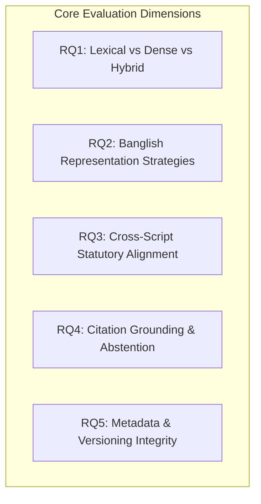
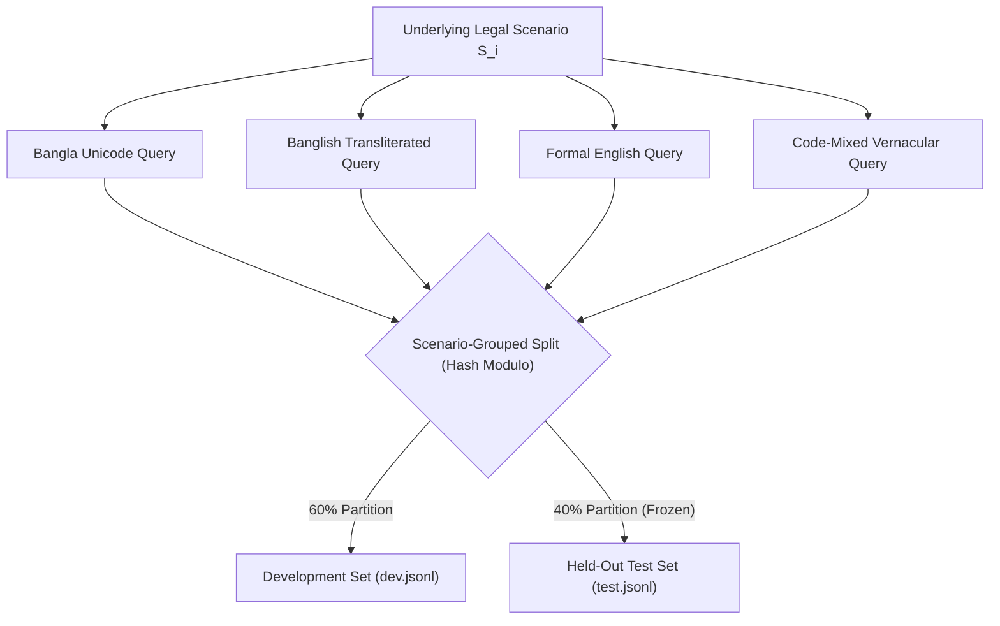

# Legal Aid BD — Formal Empirical Research Protocol

**Project Title**: *Cross-Script and Multilingual Legal Retrieval for Bangladesh: Evaluating Banglish-Aware Retrieval, Hybrid Search, and Citation Grounding*  
**Document Identifier**: `DOC-RES-PROT-W0-004`  
**Registration Stage**: Pre-Registered Research Protocol (Frozen before Week 1 Execution)  
**Lead Architecture**: AI Research Engineering & Legal Informatics Group  
**Target Venue**: Empirical Methods in NLP / International Conference on Artificial Intelligence and Law (ICAIL)  

---

## 1. Abstract & Research Framing

Access to statutory legal remedies in Bangladesh is severely constrained by linguistic and orthographic divides:
1. **Linguistic Bimodality**: Historical and commercial statutory law is codified predominantly in colonial-era English (e.g., *Contract Act, 1872*; *Transfer of Property Act, 1882*), while modern public and social legislation is enacted in Bangla Unicode (*ভোক্তা-অধিকার সংরক্ষণ আইন, ২০০৯*; *বাংলাদেশ শ্রম আইন, ২০০৬*).
2. **Orthographic Heterogeneity**: The vast majority of mobile citizens seeking informal legal assistance formulate legal queries in **Banglish** (Bengali phonetically transcribed into Latin script) or English-Bengali code-mixed vernacular, neither of which matches the formal orthography of official gazettes.

This research presents the first formal empirical benchmark comparing lexical tokenization, multilingual dense bi-encoders, hybrid reciprocal rank fusion (RRF), character n-gram indexing, and Banglish-aware representations across statutory Bangladesh law. Furthermore, it quantifies the impact of retrieval precision on deterministic citation grounding and claim-level hallucination reduction in downstream generation.

---

## 2. Research Questions (RQs) & Falsifiable Hypotheses



### RQ1: Lexical (BM25) vs. Multilingual Semantic Dense Retrieval
*How do properly tokenized BM25 lexical baselines compare against multilingual semantic embeddings on formal Bangladesh statutory provisions?*
- **$H_{0,1}$**: Multilingual dense embeddings (`BAAI/bge-m3`, `multilingual-e5-base`) do not produce a statistically significant increase in nDCG@10 compared to an explicitly tokenized Bengali-English BM25 baseline on formal monolingual queries ($p \ge 0.05$).
- **$H_{1,1}$**: Multilingual dense embeddings outperform BM25 on conceptual paraphrases and synonym expansion by at least 15% relative nDCG@10 ($p < 0.01$).

### RQ2: Banglish-Aware Retrieval vs. Unmodified Baselines
*Which retrieval strategy provides the most resilient access when user queries are formulated in informal Banglish transliteration?*
- **$H_{0,2}$**: Applying character n-gram indexing or Banglish-aware embeddings (`triBne-E5-small`) provides no statistically significant gain in Recall@10 over standard word-level BM25 on Banglish queries ($p \ge 0.05$).
- **$H_{1,2}$**: Character n-gram BM25 and Banglish-aware representations achieve $>25\%$ higher Recall@10 than unmodified standard word BM25 and standard dense embeddings on real-world Banglish queries.

### RQ3: Cross-Script & Cross-Lingual Statutory Alignment
*Can semantic bi-encoders align vernacular queries (Bangla/Banglish) with English colonial statutes without prior translation?*
- **$H_{0,3}$**: Zero-shot dense retrieval between Bangla queries and English statutory provisions exhibits an nDCG@10 penalty greater than 40% compared to native English-to-English queries.
- **$H_{1,3}$**: Hybrid retrieval (BM25 + BGE-M3 dense with RRF) narrows the cross-lingual performance gap to within 15% of monolingual retrieval performance.

### RQ4: Citation Grounding, Claim-Level Support & Abstention
*Does improving retrieval precision directly reduce hallucinated legal citations and improve safe abstention when statutory evidence is absent?*
- **$H_{0,4}$**: Grounding local LLM generation with verified top-3 retrieved passages does not yield a statistically significant reduction in ungrounded legal claims compared to an ungrounded zero-shot LLM baseline.
- **$H_{1,4}$**: Grounding with deterministic citation verification eliminates $>95\%$ of fabricated section references and enables $>85\%$ correct abstention on out-of-corpus legal questions.

### RQ5: Impact of Source Format Defects & Incomplete Amendment Metadata
*How do unstructured legislative amendments and incomplete effective dates impact retrieval reliability and legal status verification?*
- **$H_{0,5}$**: Point-in-time legal questions can be answered with $>90\%$ accuracy using automated footnote parsing from unverified portal text.
- **$H_{1,5}$**: Unverified amendment footnotes induce substantial retrieval error; restricting historical retrieval strictly to verified Gazette instruments is required to maintain defensible legal accuracy.

---

## 3. Scope of Initial Validated Corpus (3–4 Domains)

To balance clinical legal rigor against the 8-week timeline, the initial validated corpus covers **4 high-impact domains**:

```text
1. Land, Tenancy, and Housing Law
   ├── Premises Rent Control Act, 1991 (বাড়ি ভাড়া নিয়ন্ত্রণ আইন, ১৯৯১)
   ├── Transfer of Property Act, 1882 (Sections 54, 105-111)
   ├── State Acquisition and Tenancy Act, 1950 (Selected Core Provisions)
   └── Land Reform Act, 2023 (ভূমি সংস্কার আইন, ২০২৩)

2. Consumer Rights & Public Safety
   ├── Consumer Rights Protection Act, 2009 (ভোক্তা-অধিকার সংরক্ষণ আইন, ২০০৯)
   └── Consumer Rights Protection Rules & Adjudication Standards

3. Labour, Employment, and Workplace Compensation
   ├── Bangladesh Labour Act, 2006 (বাংলাদেশ শ্রম আইন, ২০০৬ - Consolidated)
   ├── Bangladesh Labour (Amendment) Acts, 2013 & 2018
   └── Bangladesh Labour Rules, 2015 (Selected provisions)

4. Contractual Obligations & Commercial Transactions
   ├── The Contract Act, 1872 (Sections 1-75)
   └── The Specific Relief Act, 1877 (Specific Performance Provisions)
```

---

## 4. Benchmark Construction & Split Integrity Protocol



### 4.1 Scenario-Grouped Splitting (Anti-Leakage Invariant)
A critical flaw in multilingual retrieval benchmarks is random query splitting, which places a Bangla query in `train/dev` and its English or Banglish counterpart in `test`. Because semantic bi-encoders memorize lexical entities (e.g., Act names, section numbers), this causes severe benchmark leakage.
- **Strict Invariant**: Splitting is performed at the **Scenario level ($S_i$)**, never at the query level.
- All 4 linguistic manifestations of Scenario $S_i$ are assigned exclusively to either `dev` (60%) or the held-out `test` split (40%).

### 4.2 Query Collection Protocol
1. **Target Benchmark Size**: 200 distinct legal scenarios (yielding 800 total evaluated queries across 4 linguistic variations).
2. **Collection Tiers**:
   - *Natural Banglish*: Collected from consenting undergraduate and professional volunteers presented with hypothetical factual prompts.
   - *Controlled Synthetic Banglish*: Generated using rule-based transliteration engines (phonetic mapping, vowel omissions, numeral substitutions) and explicitly tagged as `synthetic_banglish`.
3. **Hard Negative Inclusion**: Every evaluation scenario is indexed against a minimum background corpus of 2,500 distractor legal passages to prevent artificial Recall@10 inflation.

---

## 5. Statistical Evaluation & Reporting Standards

### 5.1 Primary Metrics
- **Retrieval Metrics**: Recall@5, Recall@10, Mean Reciprocal Rank (MRR@10), Normalized Discounted Cumulative Gain (nDCG@10).
- **Generation & Grounding Metrics**:
  - *Citation Precision*: Percentage of cited sections that exist in official statutory records.
  - *Claim-Level Support*: Percentage of factual assertions directly entailed by cited passages.
  - *Abstention F1*: Harmonic mean of precision and recall on unanswerable/out-of-corpus queries.

### 5.2 Hypothesis Testing & Confidence Intervals
- Paired comparisons between retrieval conditions (e.g., BM25 vs. Hybrid RRF) will be evaluated using the **two-tailed Wilcoxon signed-rank test** for non-parametric paired differences.
- All reported metrics will include **95% bootstrap confidence intervals** computed over 1,000 bootstrap resamples across query scenarios.
- Subgroup analyses will be explicitly reported across language (Bangla vs. Banglish vs. English vs. Code-Mixed) and legal domain.

---

## 6. Source Provenance & Data Ethics Policy

1. **Checksum Provenance**: Every ingested statutory record is permanently tied to a SHA-256 hash, acquisition URL, and timestamp in `data/manifests/`.
2. **Redistribution Policy**: Official statutory texts of Bangladesh are public domain under Section 24 of the *Bangladesh Copyright Act, 2000*. Derived benchmark annotations, queries, and evaluation code will be open-sourced under an MIT / CC-BY-4.0 license.
3. **Privacy & Anonymization**: No real-world client files or confidential legal disputes are used. All scenarios are synthetic or derived from published judicial judgments.
