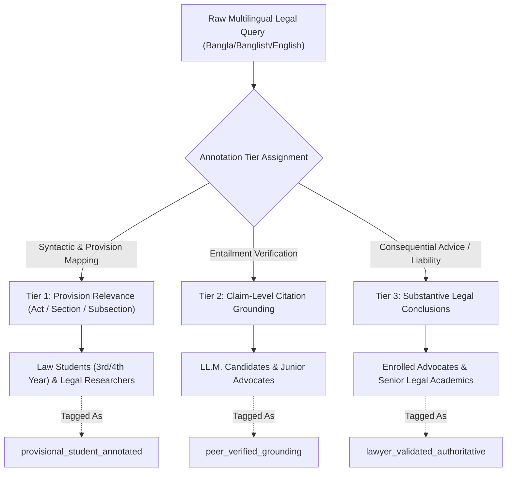

# Legal Aid BD — Legal Reviewer Onboarding, Annotation Protocol & Agreement Template

**Document Identifier**: `DOC-REV-PROT-W0-001`  
**Research Project**: *Cross-Script and Multilingual Legal Retrieval for Bangladesh: Evaluating Banglish-Aware Retrieval, Hybrid Search, and Citation Grounding*  
**Milestone**: Week 0 Feasibility Gate & Week 3 / Week 8 Human Review Protocol  
**Version**: 1.0 (Frozen)  

---

## 1. Objective & Purpose

The objective of this protocol is to establish a rigorous, ethically sound, and methodologically defensible framework for engaging Bangladesh legal scholars, advocates, and advanced law students in validating:
1. **Gold Retrieval Targets**: Identifying the precise statutory provisions (Act, Section, Subsection) governing factual scenarios presented in Bangla, English, Banglish, and Code-Mixed queries.
2. **Claim-Level Citation Grounding**: Verifying whether retrieved statutory passages logically entail and substantiate generated legal answers versus merely sharing topical keywords.
3. **Statutory Ambiguity Logging**: Documenting unresolved legal gaps or conflicting judicial interpretations rather than forcing arbitrary single-ground-truth labels.

---

## 2. Reviewer Profile & Qualification Matrix

To preserve epistemic integrity, annotators and reviewers must be profiled across academic credentials, Bar Council enrollment status, and domain expertise.

| Field | Reviewer 1 (Primary) | Reviewer 2 (Cross-Validation) | Reviewer 3 (Senior Arbiter) |
|---|---|---|---|
| **Full Legal Name** | *[Insert Name]* | *[Insert Name]* | *[Insert Name]* |
| **Institutional Affiliation** | *[e.g., University of Dhaka / Supreme Court Bar]* | *[Insert Affiliation]* | *[Insert Affiliation]* |
| **Primary Legal Qualification** | LL.B. (Hons) / LL.M. / Bar-at-Law | LL.B. (Hons) / LL.M. | Advocate, Bangladesh Bar Council / Faculty |
| **Bar Council Enrollment No.** | *[Enrollment No. or N/A (Student)]* | *[Enrollment No. or N/A]* | *[Enrollment No.]* |
| **Years of Active Practice / Study** | *[e.g., Final Year LL.B / 3 Yrs Practice]* | *[e.g., LL.M Candidate]* | *[e.g., 7+ Years Practice]* |
| **Verified Legal Domains** | <ul><li>[ ] Land & Tenancy</li><li>[ ] Consumer Protection</li><li>[ ] Labour & Employment</li><li>[ ] Contract Law</li></ul> | <ul><li>[ ] Land & Tenancy</li><li>[ ] Consumer Protection</li><li>[ ] Labour & Employment</li><li>[ ] Contract Law</li></ul> | <ul><li>[ ] Land & Tenancy</li><li>[ ] Consumer Protection</li><li>[ ] Labour & Employment</li><li>[ ] Contract Law</li></ul> |
| **Designated Reviewer Tier** | Tier 1 / Tier 2 / Tier 3 | Tier 1 / Tier 2 | Tier 3 (Arbitration Lead) |

---

## 3. Annotation Scope & Responsibility Tiers

Legal analysis requires varying degrees of clinical expertise. Reviewers are assigned strictly according to tiered responsibility thresholds:



### Tier 1 — Provision Relevance Annotation
- **Eligible Annotators**: 3rd/4th-year LL.B. students, LL.M. candidates, legal researchers.
- **Task**: Given a user query scenario $q$, search the corpus to identify the candidate Act(s) and Section(s) that directly address the scenario.
- **Output Schema**:
  ```json
  {
    "query_id": "Q_LAND_042",
    "relevant_provisions": [
      {"act": "Premises Rent Control Act, 1991", "section": "18", "subsection": "1"}
    ],
    "relevance_grade": "Definitive" // Definitive | Contextual | Peripheral
  }
  ```
- **Metadata Tag**: All annotations at this tier not yet reviewed by an advocate must be stamped with: `annotation_status: "provisional_student_annotated"`.

### Tier 2 — Claim-Level Citation Support & Entailment
- **Eligible Annotators**: LL.M. candidates, legal researchers, junior advocates (1+ years practice).
- **Task**: Deconstruct a system-generated legal response into atomic claims $\{c_1, c_2, \dots, c_k\}$. For each claim $c_i$ and cited statutory passage $p_i$, grade:
  - `Fully Supported`: Passage $p_i$ explicitly states or directly entails claim $c_i$.
  - `Partially Supported`: Passage $p_i$ supports the principle but requires unstated inferences or contextual assumptions.
  - `Unsupported / Extrapolated`: Passage $p_i$ shares topical keywords with $c_i$ but does not justify the conclusion.
  - `Contradicted`: Passage $p_i$ directly conflicts with claim $c_i$.

### Tier 3 — Consequential Legal Conclusions & Risk Flagging
- **Eligible Annotators**: Enrolled Advocates of the Supreme Court or District Bar, or Law Faculty members.
- **Task**: Evaluate whether the synthesized answer could cause material legal prejudice, misstate limitation periods, mischaracterize cognizable offenses, or overlook recent statutory amendments.
- **Strict Constraint**: Under no circumstances may an undergraduate law student validate Tier 3 consequential legal correctness. Any dataset claims regarding "lawyer-validated correctness" MUST be countersigned by an enrolled advocate.

---

## 4. Inter-Annotator Agreement & Disagreement Resolution

To prevent subjective bias and ensure empirical replicability, a formal dual-annotation protocol is enforced:

### 4.1 Dual-Review Subset
1. **Sample Size**: Exactly **20%** of all benchmark cases (minimum 40 cases from the planned 200-query benchmark) are independently annotated by two blind reviewers ($R_1$ and $R_2$).
2. **Metric Reporting**:
   - For categorical relevance (Relevant vs. Irrelevant): Compute **Cohen’s Kappa ($\kappa$)** or **Gwet’s $AC_1$**.
   - For graded ordinal relevance (0: Irrelevant, 1: Topical, 2: Highly Relevant, 3: Gold Standard): Compute **Weighted Kappa ($\kappa_w$)** and **Krippendorff’s Alpha ($\alpha$)**.
   - **Quality Threshold**: A minimum inter-annotator agreement score of $\kappa \ge 0.70$ is mandatory before freezing the Week 3 benchmark.

### 4.2 Ambiguity Preservation Protocol
In statutory interpretation, certain scenarios do not have a single unambiguous statutory resolution (e.g., overlapping remedies between the *Consumer Rights Protection Act, 2009* and the *Penal Code, 1860*, or unnotified effective dates).
- **Rule**: If two qualified reviewers disagree because the underlying law itself contains conflicting provisions or judicial ambiguities, **annotators are forbidden from forcing an arbitrary consensus label**.
- **Action**: The record must be flagged as `statutory_ambiguity_present: true`, both interpretations logged, and the query categorized in the benchmark's "Complex / Discretionary" evaluation partition.

### 4.3 Split Decision Escalation Hierarchy
When disagreement stems from interpretative divergence rather than statutory ambiguity:
```text
Reviewer 1 (Annotation) <---> Reviewer 2 (Blind Counter-Annotation)
                             │
                     [Disagreement Detected]
                             │
                             ▼
         Tier 3 Senior Arbiter (Advocate / Faculty Lead)
                             │
     ┌───────────────────────┴───────────────────────┐
     ▼                                               ▼
[Substantive Consensus Reached]           [Unresolvable Statutory Conflict]
Record logged with Arbiter Rationale      Flagged as `statutory_ambiguity_present`
```

---

## 5. Workload Commitment, Turnaround & Consent Agreement

### 5.1 Milestone Schedule & Review Capacity

| Milestone | Target Dates | Task Description | Expected Review Volume | Estimated Hours |
|---|---|---|---|---|
| **Week 0** | Feasibility Gate | Reviewer protocol sign-off & scope approval | 1 Protocol review | 2 Hours |
| **Week 3** | Benchmark Construction | Gold evidence annotation & dual-review subset | 100–200 queries (subdivided) | 12–16 Hours |
| **Week 5** | Grounded Q&A | Claim-level citation support audit (sample) | 40 generated answers | 6–8 Hours |
| **Week 8** | Final Evaluation | Error analysis audit on high-stakes failures | 30 edge-case answers | 4–6 Hours |

### 5.2 Ethical Attribution & Authorship Criteria (ICMJE Alignment)
In accordance with international academic integrity standards (ICMJE guidelines):
- **Co-Authorship Eligibility**: Reviewers who actively participate in benchmark conceptualization, author substantial annotation guidelines, resolve domain-level statutory conflicts, and review/edit manuscript drafts will be credited as **co-authors** on peer-reviewed publications.
- **Formal Academic Acknowledgment**: Reviewers who perform standardized Tier 1/Tier 2 annotation without contributing to manuscript drafting or experimental design will be formally credited in the **Acknowledgements** section with explicit mention of their institutional affiliation.

---

## 6. No-Reviewer Fallback Clause (Binding Safety Mechanism)

> [!CAUTION]
> **Contingency Rule**: If a qualified legal professional (enrolled advocate or law faculty member) cannot be formally onboarded by the conclusion of Week 0:
> 1. The research project **must immediately downscope its empirical claims**.
> 2. All retrieval labels produced internally by the engineering team must be explicitly designated in all documentation and publications as:  
>    `annotation_status: "researcher_annotated_provisional"`.
> 3. The project will evaluate **retrieval recall and cross-script ranking quality only**.
> 4. The research paper must explicitly disclaim:  
>    *"This benchmark evaluates information retrieval relevance against researcher-curated statutory references and does NOT claim lawyer-validated legal advice or clinical correctness."*

---

## 7. Reviewer Sign-Off Block

### Reviewer Acceptance & Consent
I hereby confirm that I have reviewed the Legal Aid BD research protocol, agree to adhere to the tiered annotation and ambiguity preservation guidelines, and consent to my contributions being acknowledged / co-authored as determined above.

**Reviewer Name**: ________________________________________________  
**Designation / Bar ID**: ___________________________________________  
**Date**: ________________________  
**Signature**: ____________________________________________________  

### Lead Researcher Countersignature
**Researcher Name**: _______________________________________________  
**Date**: ________________________  
**Signature**: ____________________________________________________  
