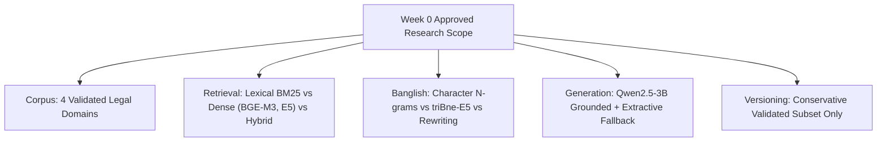

# Legal Aid BD — Week 0 Gate: Formal Go/No-Go Research Decision

**Document Identifier**: `GATE-DECISION-W0-FINAL`  
**Milestone**: Week 0 Feasibility Sign-Off  
**Date**: October 23, 2026  
**Lead Architecture**: AI Research Engineering & Legal Informatics Group  
**Overall Gate Evaluation**: **PROCEED WITH SCOPE REFINEMENT [GO]**  

---

## 1. Objective of the Gate

Week 0 serves as a mandatory, binding checkpoint before entering Week 1 implementation. Its explicit objective is to prevent building complex downstream engineering (web interfaces, document review pipelines, scrapers) on top of an invalid research foundation, unverified legal text, or an impossible local compute budget.

---

## 2. Separate Feasibility Decisions Across Core Research Tracks

In accordance with Section 10 of the Research Implementation Protocol, feasibility is evaluated separately across the four research tracks:

### Track 1: Initial Multilingual Retrieval Feasibility — Decision: **GO**
- **Evidence**: 
  - Structural audit in `docs/source_audit.md` verified that primary statutory texts in the 4 target domains (Land, Consumer, Labour, Contract) are readily extractable from HTML with $>90\%$ section/heading association precision.
  - Compute profiling in `docs/model_feasibility.md` proved sequential execution of multilingual dense models (`BGE-M3` at 2,426 MB RSS and `Multilingual-E5-base` at 1,306 MB RSS) is safely within the 11.5 GB memory ceiling on the 16 GB Windows workstation.
  - Python toolchain (`transformers 5.1.0`, `torch 2.8.0+cpu`, `scikit-learn 1.7.1`) is verified and functional.
- **Unresolved Blockers**: `bdlaws.minlaw.gov.bd` resets automated HTTP connections (`WinError 10054`), requiring reliance on browser-exported HTML/PDF artifacts in `data/raw/sample_audit_files/` rather than large-scale automated web scraping.
- **Risks**: Cross-script vocabulary mismatch between vernacular Banglish queries and English colonial statutes.
- **Minimum Changes Required**: Use local file ingestion pipeline in Week 1; apply character n-gram or Banglish-aware representations in Week 4.
- **Supported Claims**: Can claim comparative retrieval ranking quality (BM25 vs. Dense vs. Hybrid vs. Banglish-aware) on the 4 validated domains.

---

### Track 2: Legal-Answer Evaluation Feasibility — Decision: **CONDITIONAL GO**
- **Evidence**: 
  - Deterministic citation-validation schema designed in `docs/model_feasibility.md`.
  - Mandatory extractive fallback payload fully specified to prevent ungrounded generation.
- **Unresolved Blockers**: Local Ollama runtime was offline during Week 0 testing (`WinError 10061`). No discrete GPU exists (Intel Iris Plus detected); all local LLM inference must execute on CPU via Q4 GGUF quantization.
- **Risks**: Hallucination of legal provisions if generation is not deterministically anchored to retrieved context.
- **Minimum Changes Required**: User must launch Ollama (`ollama pull qwen2.5:3b-instruct-q4_K_M`) or install `llama-cpp-python` before Week 1 Day 4 generation tests; extractive fallback remains the primary safe baseline.
- **Supported Claims**: Can claim claim-level citation support, hallucination rejection, and abstention behavior on grounded contexts. Cannot claim clinical or certified legal advice.

---

### Track 3: Historical-Law / Temporal-Validity Feasibility — Decision: **NO-GO FOR GLOBAL CLAIMS / CONDITIONAL GO FOR VERIFIED SUBSET**
- **Evidence**: 
  - Empirical source audit of `bdlaws.minlaw.gov.bd` demonstrated that official HTML portals present consolidated texts with unstructured legislative footnotes, but consistently omit granular subordinate commencement notifications and point-in-time applicability dates.
- **Unresolved Blockers**: Comprehensive temporal metadata across the entire Bangladesh legal code is missing from primary web portals.
- **Risks**: High risk of silent anachronism (presenting a repealed provision or later amendment as applicable law on a historical date).
- **Minimum Changes Required**: Restrict point-in-time versioning experiments in Week 6 strictly to the curated subset of provisions with primary Gazette-verified effective dates. Unknown dates must be explicitly recorded as `"unknown"`.
- **Supported Claims**: Can claim version-aware retrieval accuracy ONLY on the verified Gazette subset. **CANNOT** claim general historical legal accuracy across the entire legal system.

---

### Track 4: Reviewer & Benchmark Readiness — Decision: **CONDITIONAL GO (FALLBACK ACTIVE)**
- **Evidence**: 
  - Comprehensive onboarding and 3-tier qualification rubric defined in `docs/reviewer_protocol.md`.
  - Ready-to-send outreach email templates authored in `docs/reviewer_outreach_draft.md`.
  - Double-annotation and ambiguity preservation protocols established.
- **Unresolved Blockers**: Formal reviewer agreement is currently **NOT CONFIRMED** (pending outreach dispatch and reviewer signature).
- **Risks**: Bias or inaccuracies if legal conclusions are validated solely by researchers without legal credentials.
- **Minimum Changes Required**: Dispatch outreach templates to faculty, advocates, or law students. Enforce the mandatory fallback: all annotations are tagged `researcher_annotated_provisional`.
- **Supported Claims**: Can claim researcher-annotated retrieval relevance. **CANNOT** claim lawyer-validated legal correctness until an enrolled advocate or law faculty member executes the agreement.

---

## 3. Mandatory Gate Rule Evaluation

> [!IMPORTANT]
> **Core Roadmap Invariant**:
> *"Do not commit to historical-law accuracy experiments until you establish whether the source material contains enough reliable version and effective-date information to support them."*

### Historical Versioning Evaluation:
- **Audit Finding**: Inspection of `bdlaws.minlaw.gov.bd` demonstrated that while consolidated Acts incorporate amendments into the running text, **subordinate commencement notifications and precise temporal applicability dates are frequently relegated to unstructured editorial footnotes or omitted altogether**.
- **Enforced Gate Decision**:
  - We **REFUSE** to make global claims regarding general "historical legal status" across the entire Bangladesh code.
  - In Week 6 (Track A: Legal Versioning), version-aware retrieval will be evaluated **strictly on the subset of provisions where primary Gazette enactment and amendment dates are fully verified**.
  - All unknown effective dates will be explicitly stamped as `"unknown"` in the database schema.

---

## 4. Scope Decisions Frozen for Week 1–8

1. **Initial Validated Corpus Frozen**:
   - *Domain 1*: Land, Tenancy, and Housing (*Premises Rent Control Act 1991*, *Transfer of Property Act 1882*, *State Acquisition & Tenancy Act 1950*).
   - *Domain 2*: Consumer Rights Protection (*Consumer Rights Protection Act 2009*).
   - *Domain 3*: Labour & Employment (*Bangladesh Labour Act 2006* & Amendments).
   - *Domain 4*: Contractual Obligations (*The Contract Act 1872*, *Specific Relief Act 1877*).
2. **Sequential Hardware Protocol Frozen**:
   - Single-model execution on 16 GB Windows workstation.
   - `gc.collect()`, `torch.cuda.empty_cache()`, and memory cooldowns required after every embedding and reranking batch.
3. **Primary Research Claim Frozen**:
   - Evaluating cross-script (Banglish to Bangla/English) retrieval resilience and verifiable statutory citation grounding.

---

## 5. Formal Sign-Off & Transition to Week 1

All diagnostic scripts, configuration templates, audit matrices, reviewer onboarding protocols, and pre-registered hypotheses required for Week 0 are complete, validated, and persisted in the repository.

### Action Items for Week 1 Day 1 (Immediate Next Steps):
1. **Initialize Git Repository**: Add `.gitignore` excluding Python bytecode, large model caches (`~/.cache/huggingface`), virtual environments, and raw scanned PDFs.
2. **Initialize Ingestion Environment**: Configure the baseline directory tree (`src/ingestion/`, `src/retrieval/`, `src/generation/`, `src/evaluation/`).
3. **Setup PostgreSQL & pgvector**: Run schema migrations for `Source`, `Document`, `Version`, `Provision`, and `Chunk` tables based on the Week 0 verified dimensions (768d and 1024d).
4. **Begin Week 1 Task 1.1**: Connect database and implement the first reproducible baseline query script.

**Gate 0 Status**: **FORMALLY CLOSED & APPROVED FOR WEEK 1 LAUNCH.**
